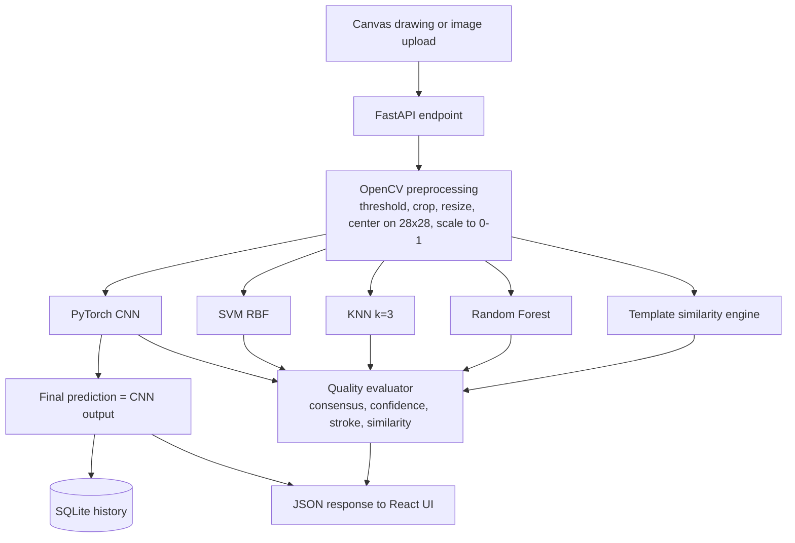

# Handwritten Digit Recognition System


An end-to-end web application that recognises handwritten digits (0 to 9) in real time. Draw a digit on a canvas or upload an image. A custom **PyTorch CNN** classifies it, three classical machine-learning models (**SVM, KNN, Random Forest**) cross-check the result, and the app rates the quality of your handwriting.

---

## Table of Contents

1. [Overview](#1-overview)
2. [Demo](#2-demo)
3. [Features](#3-features)
4. [How It Works](#4-how-it-works)
5. [Dataset](#5-dataset)
6. [Model Architecture and Training](#6-model-architecture-and-training)
7. [Results and Evaluation](#7-results-and-evaluation)
8. [Installation](#8-installation)
9. [Usage](#9-usage)
10. [API Reference](#10-api-reference)
11. [Configuration](#11-configuration)
12. [Testing](#12-testing)
13. [Docker](#13-docker)
14. [Project Structure](#14-project-structure)
15. [Tech Stack](#15-tech-stack)
16. [Known Limitations and Future Work](#16-known-limitations-and-future-work)
17. [Contributing](#17-contributing)
18. [License](#18-license)
19. [Author and Acknowledgements](#19-author-and-acknowledgements)

---

## 1. Overview

**Problem.** Reading handwritten digits is easy for people but hard for computers, because every person writes differently. A useful recognition system must handle different stroke widths, sizes and positions.

**Solution.** This project is a full-stack system with three parts:

1. A **React frontend** where the user draws or uploads a digit.
2. A **FastAPI backend** that cleans the image (OpenCV), runs four classifiers, scores the handwriting, and saves a history of predictions in SQLite.
3. A **model dashboard** that shows how the models were evaluated (accuracy, confusion matrix, per-digit metrics) and an interactive diagram of the ML pipeline.

**Who it is for.** Students learning machine learning, and anyone who wants to see a complete example that goes from a trained model to a working web app.

---

## 2. Demo

<!-- TODO: add screenshots or a GIF to a docs/ folder and update the paths below. -->

| Screen | Preview |
| :--- | :--- |
| Predictor: draw a digit and see the prediction | `` |
| Result: confidence chart, model comparison, quality score | `` |
| Model dashboard: confusion matrix and pipeline graph | `` |
| History: past predictions with filters | `` |

---

## 3. Features

| Feature | Description |
| :--- | :--- |
| **Drawing canvas** | HTML5 canvas with brush and eraser tools, adjustable brush size (10 to 36 px) and a clear button |
| **Image upload** | Drag-and-drop or file picker for PNG, JPG, BMP and WebP images |
| **OpenCV preprocessing** | Thresholding, background-inversion check, bounding-box crop, aspect-ratio-preserving resize to fit 20×20, and centering on a 28×28 MNIST-style frame |
| **Multi-model inference** | PyTorch CNN, SVM, KNN and Random Forest all run on the same input |
| **Confidence analytics** | Softmax confidence and the full 10-class probability distribution |
| **Handwriting quality score** | A 0 to 100 score built from model agreement, confidence, stroke density and template similarity |
| **Image similarity** | Compares your drawing with the average MNIST image of each digit (cosine similarity and MSE) |
| **Blank-input protection** | An empty canvas or blank image is rejected with a clear error (HTTP 400) |
| **Prediction history** | Every prediction is saved to SQLite. Browse with pagination, filter by digit, or clear all |
| **Model dashboard** | Accuracy, model comparison, confusion matrix, per-class performance and a draggable pipeline graph |

---

## 4. How It Works



**Step by step**

1. **Input.** The user draws on the canvas (sent as a Base64 PNG) or uploads an image file.
2. **Preprocessing.** The image is converted to grayscale, thresholded, and inverted if the background is white. The digit is cropped to its bounding box, resized to fit a 20×20 box while keeping its aspect ratio, and placed in the centre of a 28×28 image. Pixels are scaled to the range 0 to 1.
3. **Classification.** The CNN produces probabilities for the ten digits. The **final prediction is the CNN's top class**. SVM, KNN and Random Forest run on the same 28×28 input and are shown for comparison.
4. **Analysis.** The similarity engine compares the image with the average image of each digit. The quality evaluator combines everything into one score.
5. **Output.** The prediction is stored in SQLite and returned as JSON. The React UI shows the digit, a probability chart, the model comparison, the quality score and the similarity breakdown.

### Handwriting quality score

```
score = 40% model consensus + 30% mean confidence + 20% stroke clarity + 10% template similarity
```

| Score | Level |
| :---: | :--- |
| 88 or more | Excellent |
| 74 to 87.9 | Good |
| 55 to 73.9 | Fair |
| below 55 | Needs Improvement |

*Model consensus* is the share of the four models that agree with the most common answer. This score rates how clear and consistent a drawing is for the models. It is not a measure of calligraphy.

### Image similarity

For each digit 0 to 9, the drawing is compared with a template (the mean image of that digit from the MNIST training subset). The similarity is `0.6 × cosine similarity + 0.4 × exp(−3 × MSE)`, clipped to the range 0 to 1.

---

## 5. Dataset

| Item | Value |
| :--- | :--- |
| Name | [MNIST](http://yann.lecun.com/exdb/mnist/) handwritten digits |
| Training images | 60,000 |
| Test images | 10,000 |
| Image size | 28×28, grayscale |
| Classes | 10 (digits 0 to 9) |
| Location in this repo | `archive/` (raw IDX binary files) |

**Preprocessing used for training:** each image is read from the IDX file, converted to a float tensor of shape `(1, 28, 28)` and divided by 255 to give values from 0 to 1. No data augmentation is applied.

The `archive/` folder is only needed to **retrain or re-evaluate** the models. The trained weights are already included, so you can run the app without it.

---

## 6. Model Architecture and Training

### CNN (`DigitCNN`)

Input `(1, 28, 28)`. Total trainable parameters: **468,458**.

| Stage | Layers | Output shape |
| :--- | :--- | :--- |
| Block 1 | Conv 3×3 (1→32) → BN → ReLU → Conv 3×3 (32→32) → BN → ReLU → MaxPool 2×2 → Dropout2d (0.25) | 32 × 14 × 14 |
| Block 2 | Conv 3×3 (32→64) → BN → ReLU → Conv 3×3 (64→64) → BN → ReLU → MaxPool 2×2 → Dropout2d (0.25) | 64 × 7 × 7 |
| Classifier | Flatten (3136) → Linear (128) → BN → ReLU → Dropout (0.5) → Linear (10) | 10 logits |

### CNN training settings

| Setting | Value |
| :--- | :--- |
| Optimizer | Adam, learning rate 0.001 |
| Loss | Cross-entropy |
| Epochs / batch size | `training/train.py` runs **2 epochs, batch 128**. The notebook runs **3 epochs, batch 64** |
| Device | GPU if available, otherwise CPU |
| Augmentation | None |
| Output | `backend/models/digit_classifier.pt` (weights only) |

### Classical models

These are scikit-learn models trained by `training/train_classical.py` on the **first 2,500 images** of the MNIST training set (a deliberate subset to keep the repository light and training fast).

| Model | Configuration |
| :--- | :--- |
| SVM | RBF kernel, `C = 5.0`, probability estimates enabled |
| KNN | `k = 3`, distance-weighted |
| Random Forest | 100 trees, `max_depth = 15` |

---

## 7. Results and Evaluation

All results are on the **10,000-image MNIST test set**, which the models never saw during training.

### Headline numbers (CNN)

| Metric | Value |
| :--- | :---: |
| Accuracy | **99.23%** (9,923 of 10,000 correct) |
| Test loss | 0.0232 |
| Macro precision | 99.24% |
| Macro recall | 99.22% |
| Macro F1-score | 99.23% |
| Total errors | 77 |

### Model comparison

| Model | Type | Test accuracy |
| :--- | :--- | :---: |
| **PyTorch CNN** | Deep neural network | **99.23%** |
| SVM (RBF) | Classical ML | 94.16% |
| Random Forest | Ensemble (100 trees) | 92.05% |
| KNN (k = 3) | Instance-based | 91.87% |

The CNN figure comes from the saved evaluation in `backend/app/ml/artifacts/metrics.json`. The classical figures were measured by loading the saved model files in `backend/app/ml/artifacts/` and scoring them on all 10,000 test images. They trail the CNN mainly because they were trained on only 2,500 images and work on raw pixels, while the CNN learns image features and sees all 60,000 training images.

### Confusion matrix

Rows are the **actual** digit. Columns are the **predicted** digit. Bold numbers on the diagonal are correct predictions. Every other number is a mistake.

| Actual \ Pred | 0 | 1 | 2 | 3 | 4 | 5 | 6 | 7 | 8 | 9 |
| :---: | :---: | :---: | :---: | :---: | :---: | :---: | :---: | :---: | :---: | :---: |
| **0** | **977** | 0 | 0 | 0 | 0 | 0 | 1 | 1 | 1 | 0 |
| **1** | 0 | **1131** | 2 | 2 | 0 | 0 | 0 | 0 | 0 | 0 |
| **2** | 1 | 0 | **1029** | 0 | 0 | 0 | 0 | 2 | 0 | 0 |
| **3** | 0 | 0 | 0 | **1005** | 0 | 2 | 0 | 2 | 1 | 0 |
| **4** | 0 | 0 | 0 | 0 | **980** | 0 | 0 | 0 | 0 | 2 |
| **5** | 0 | 0 | 0 | 6 | 0 | **885** | 1 | 0 | 0 | 0 |
| **6** | 8 | 3 | 0 | 0 | 1 | 3 | **942** | 0 | 1 | 0 |
| **7** | 0 | 3 | 7 | 0 | 0 | 0 | 0 | **1018** | 0 | 0 |
| **8** | 1 | 0 | 2 | 1 | 2 | 0 | 0 | 3 | **962** | 3 |
| **9** | 1 | 2 | 0 | 2 | 5 | 1 | 0 | 4 | 0 | **994** |

**How to read it in simple words**

- The row `6` and column `0` says **8**: eight images that were really a 6 were predicted as a 0.
- Add a **row** to see how many images of that digit exist. Add a **column** to see how often the model predicted that digit.
- *Recall* of a digit = diagonal ÷ row total (how many real 7s were found). *Precision* = diagonal ÷ column total (how often a predicted 7 was really a 7).

### Per-digit metrics (CNN)

| Digit | Precision | Recall | F1-score | Test images |
| :---: | :---: | :---: | :---: | :---: |
| 0 | 98.89% | 99.69% | 99.29% | 980 |
| 1 | 99.30% | 99.65% | 99.47% | 1,135 |
| 2 | 98.94% | 99.71% | 99.32% | 1,032 |
| 3 | 98.92% | 99.50% | 99.21% | 1,010 |
| 4 | 99.19% | 99.80% | 99.49% | 982 |
| 5 | 99.33% | 99.22% | 99.27% | 892 |
| 6 | 99.79% | 98.33% | 99.05% | 958 |
| 7 | 98.83% | 99.03% | 98.93% | 1,028 |
| 8 | 99.69% | 98.77% | 99.23% | 974 |
| 9 | 99.50% | 98.51% | 99.00% | 1,009 |

The model is consistent across all digits (every F1-score is between 98.9% and 99.5%). The lowest recall is for **6** (98.33%) and **9** (98.51%). The lowest precision is for **7** (98.83%) and **0** (98.89%).

### Most confused digit pairs

| Actual → Predicted | Times | Likely reason |
| :--- | :---: | :--- |
| 6 → 0 | 8 | A 6 with a small or closed lower loop looks like a 0 |
| 7 → 2 | 7 | A 7 with a long top stroke and a curved tail resembles a 2 |
| 5 → 3 | 6 | Both digits share similar curved strokes in the lower half |
| 9 → 4 | 5 | An open-topped 9 looks like a 4 |
| 9 → 7 | 4 | A 9 with a short, straight tail looks like a 7 |

These are plausible visual explanations, not proven causes. With only 77 errors in 10,000 images, each pair involves a handful of images.

> **Important.** These numbers measure performance on the MNIST test set. MNIST digits are already centred and cleaned, so accuracy on your own drawings or photos can be lower, even though the preprocessing step tries to match the MNIST style.

---

## 8. Installation

### Prerequisites

- **Python 3.11** (the version used by the Docker image)
- **Node.js 20.19 or newer** and npm (required by the Vite 8 / ESLint 10 toolchain)
- Git

### Step 1: Get the code

```bash
git clone https://github.com/<your-username>/<your-repo>.git
cd <your-repo>
```

### Step 2: Backend

```bash
cd backend

# Create and activate a virtual environment
python -m venv venv
# Windows PowerShell:  .\venv\Scripts\Activate.ps1
# Windows CMD:         venv\Scripts\activate.bat
# macOS / Linux:       source venv/bin/activate

pip install -r requirements.txt

# Optional: create your environment file
cp .env.example .env          # Windows PowerShell: Copy-Item .env.example .env
```

### Step 3: Frontend

```bash
cd Frontend
npm install
```

*(Run the frontend commands from the `Frontend/` folder, which sits next to `backend/`.)*

---

## 9. Usage

### Run the backend

```bash
cd backend
uvicorn app.main:app --reload --host 0.0.0.0 --port 8000
```

| URL | What it is |
| :--- | :--- |
| `http://localhost:8000/api/v1` | API base URL |
| `http://localhost:8000/docs` | Swagger UI (try the API in the browser) |
| `http://localhost:8000/redoc` | ReDoc documentation |

The trained CNN weights and classical-model files are already included, so no training is needed. The SQLite database (`predictions.db`) and the `uploads/` folder are created and used automatically.

### Run the frontend

```bash
cd Frontend
npm run dev
```

Open `http://localhost:5173`. To use a different backend address, create `Frontend/.env` with:

```
VITE_API_BASE_URL=http://localhost:8000/api/v1
```

Other frontend commands: `npm run build` (production build), `npm run preview`, `npm run lint`.

### Using the app

1. Open the **Predictor** page.
2. Choose **Drawing Canvas Mode** and draw a digit (or choose **Image File Upload Mode** and add an image).
3. Click **Classify Digit**.
4. Read the predicted digit, confidence chart, model comparison, quality score and similarity result.
5. Open **History** to review past predictions, and **Model** to see the evaluation dashboard.

### Call the API directly

```bash
# Health check
curl http://localhost:8000/api/v1/health

# Predict from an image file
curl -X POST http://localhost:8000/api/v1/predict/image -F "file=@digit.png"

# Get the 20 most recent predictions of the digit 7
curl "http://localhost:8000/api/v1/history?limit=20&digit=7"
```

### Retrain or re-evaluate (optional)

These scripts read the raw MNIST files from `archive/`.

```bash
cd backend

python training/train.py             # train the CNN  -> models/digit_classifier.pt
python training/train_classical.py   # train SVM / KNN / RF and the digit templates
python training/evaluate.py          # print classification report and confusion matrix
python training/generate_metrics.py  # regenerate app/ml/artifacts/metrics.json
```

There is also a training notebook: `backend/notebooks/handwritten_digit_training.ipynb`.

---

## 10. API Reference

Base path: `/api/v1`

| Method | Endpoint | Description |
| :--- | :--- | :--- |
| `GET` | `/health` | Service status, whether the model is loaded, and the compute device |
| `POST` | `/predict/canvas` | Predict from a Base64 canvas image. Body: `{"image_data": "data:image/png;base64,..."}`. `POST /predict` is an alias |
| `POST` | `/predict/image` | Predict from an uploaded file (`multipart/form-data`, field name `file`; PNG, JPG, BMP or WebP) |
| `GET` | `/model/info` | Model metadata, accuracy, loss, confusion matrix and class labels |
| `POST` | `/model/reload` | Reload the CNN weights from disk |
| `GET` | `/history` | Paginated history. Query: `skip` (default 0), `limit` (1 to 200, default 50), optional `digit` (0 to 9) |
| `DELETE` | `/history/clear` | Delete all history records |

Errors such as a blank drawing, an unsupported file type or an empty upload return **HTTP 400** with a `detail` message.

### Example response: `POST /predict/canvas`

Values are illustrative and shortened.

```json
{
  "predicted_digit": 7,
  "digit_name": "Seven",
  "confidence": 0.99,
  "confidence_scores": { "0": 0.0, "7": 0.99, "9": 0.01 },
  "probabilities": [{ "digit": 7, "name": "Seven", "confidence": 0.99 }],
  "algorithm_predictions": {
    "cnn": { "predicted_digit": 7, "confidence": 0.99 },
    "svm": { "predicted_digit": 7, "confidence": 0.91 },
    "knn": { "predicted_digit": 7, "confidence": 1.0 },
    "random_forest": { "predicted_digit": 7, "confidence": 0.62 }
  },
  "handwriting_quality": {
    "quality_score": 82.6,
    "quality_level": "Good",
    "feedback": "Well-formed digit stroke with strong classification alignment (4/4 models agree).",
    "consensus_count": 4,
    "total_algorithms": 4
  },
  "image_similarity": {
    "top_match_digit": 7,
    "overall_similarity_percentage": 82.0
  },
  "record_id": 12,
  "created_at": "2026-11-21T10:30:00Z"
}
```

---

## 11. Configuration

Backend settings live in `backend/.env` (copy it from `.env.example`).

| Variable | Default | Purpose |
| :--- | :--- | :--- |
| `PROJECT_NAME` | `Handwritten Digit Classifier API` | API title shown in the docs |
| `API_V1_STR` | `/api/v1` | API route prefix |
| `DATABASE_URL` | `sqlite:///./predictions.db` | History database. **Set this as a shell environment variable**, because the database layer reads it with `os.getenv` and does not load `.env` |
| `LOG_LEVEL` | `INFO` | Listed in `.env.example` but **not used by the code yet** |

Frontend: `VITE_API_BASE_URL` (default `http://localhost:8000/api/v1`).

---

## 12. Testing

```bash
cd backend
python -m pytest
```

The suite has **11 tests** in four files:

| File | What it checks |
| :--- | :--- |
| `test_health.py` | Root and health endpoints |
| `test_preprocessing.py` | Normalisation, centering/resizing, canvas decoding |
| `test_model.py` | CNN forward pass and the predictor |
| `test_prediction.py` | Canvas prediction, blank-canvas rejection (HTTP 400), image upload, history endpoints |

---

## 13. Docker

Only the backend is containerised.

```bash
cd backend
docker build -t handwritten-digit-backend .
docker run -p 10000:10000 handwritten-digit-backend
```

The container listens on the `$PORT` environment variable (default `10000`), which suits hosting platforms such as Render. The API is then available at `http://localhost:10000/api/v1`.

---

## 14. Project Structure

```
<project-root>/
├── archive/                          # MNIST dataset (IDX files) - only needed for training
├── backend/
│   ├── app/
│   │   ├── api/routes/               # health, prediction, model, history endpoints
│   │   ├── core/                     # constants, exceptions
│   │   ├── database/                 # SQLAlchemy engine, ORM model, repositories
│   │   ├── ml/
│   │   │   ├── artifacts/            # SVM/KNN/RF models, digit templates, metrics.json
│   │   │   ├── model_architecture.py # DigitCNN definition
│   │   │   ├── model_loader.py       # loads and caches CNN weights
│   │   │   ├── classical_models.py   # SVM, KNN, Random Forest
│   │   │   ├── predictor.py          # runs all models and assembles the result
│   │   │   ├── quality_evaluator.py  # handwriting quality score
│   │   │   └── similarity_engine.py  # template similarity
│   │   ├── preprocessing/            # canvas decoding, OpenCV centering, normalisation
│   │   ├── schemas/                  # Pydantic request/response models
│   │   ├── services/                 # prediction, preprocessing, model, history logic
│   │   ├── utils/                    # image helpers, logger
│   │   ├── config.py                 # settings
│   │   ├── dependencies.py           # dependency injection
│   │   └── main.py                   # FastAPI app entry point
│   ├── models/digit_classifier.pt    # trained CNN weights
│   ├── notebooks/                    # training notebook
│   ├── tests/                        # pytest suite
│   ├── training/                     # dataset loader, train / evaluate / metrics scripts
│   ├── uploads/                      # saved uploaded images
│   ├── Dockerfile
│   ├── requirements.txt
│   └── .env.example
└── Frontend/
    ├── src/
    │   ├── components/               # history, home, layout, model (pipeline graph), predictor
    │   ├── data/pipelineData.js      # nodes and edges of the pipeline diagram
    │   ├── pages/                    # Home, Predictor, Model, History, About, NotFound
    │   ├── services/                 # REST client (api, prediction, model, history)
    │   └── styles/                   # global styles and design variables
    ├── package.json
    └── vite.config.js
```

---

## 15. Tech Stack

| Layer | Technologies |
| :--- | :--- |
| Frontend | React 19, Vite, React Router, `@xyflow/react` (pipeline graph), Lucide icons, CSS |
| Backend | FastAPI, Uvicorn, Pydantic v2, SQLAlchemy 2, SQLite |
| Machine learning | PyTorch, torchvision, scikit-learn, NumPy |
| Image processing | OpenCV (headless), Pillow |
| Testing / DevOps | Pytest, HTTPX, Docker |

---

## 16. Known Limitations and Future Work

### Known limitations

- **MNIST only.** The models are trained and tested on MNIST. Digits that are very thick, rotated, off-centre or written in unusual styles may be misclassified, and no augmentation was used.
- **Classical models use a small subset.** They were trained on 2,500 images, so their accuracy (about 92 to 94%) is lower than it could be with the full 60,000.
- **Dashboard values for the classical models are static.** The model-comparison entries in `training/generate_metrics.py` / `metrics.json` and the `accuracy_score` fields in `app/ml/classical_models.py` are hard-coded (97.9%, 96.9%, 96.8%). They are higher than the measured values in [Section 7](#7-results-and-evaluation). Update them to match.
- **Stroke-clarity component of the quality score is not working as intended.** `quality_evaluator.py` compares pixels with a threshold of `20`, but the input is already scaled to 0 to 1, so this part always returns the same low value (0.40). As a result the total score cannot exceed 88.0, and the "Excellent" level is practically unreachable. Use a threshold on the 0 to 1 scale (for example `img > 0.08`).
- **No authentication.** History is shared by all users, and CORS allows all origins. Restrict this before any public deployment.
- **No `LICENSE` file** is included yet.

### Future improvements

- Add data augmentation (rotation, shift, scale, noise) and train for more epochs.
- Train the classical models on the full MNIST set and compute their metrics automatically instead of hard-coding them.
- Let users confirm the true digit so the app can build a live confusion matrix from real drawings.
- Add user accounts with per-user history.
- Support multi-digit recognition (for example, numbers and handwritten forms).
- Add a CI pipeline to run the tests and the linter on every push.

---

## 17. Contributing

Contributions are welcome.

1. Fork the repository and create a branch: `git checkout -b feature/my-change`
2. Make your changes and run `python -m pytest` (backend) and `npm run lint` (frontend)
3. Commit with a clear message and push the branch
4. Open a pull request that describes what you changed and why

---

## 18. License

<!-- TODO: add a LICENSE file (for example MIT) and update the badge at the top of this README. -->

This is an academic minor project. No license has been added yet; add one of your choice (for example MIT) before sharing or reusing the code.

---

## 19. Author and Acknowledgements

<!-- TODO: fill in your details. -->

- **Author:** `<Your Name>`
- **Institution / Course:** `<Your College, Course, Year>`
- **Guide / Supervisor:** `<Name>`
- **Contact:** `<Email>` | `<GitHub profile link>`

**Acknowledgements**

- [MNIST database](http://yann.lecun.com/exdb/mnist/) by Yann LeCun, Corinna Cortes and Christopher J.C. Burges
- The PyTorch, FastAPI, scikit-learn, OpenCV and React open-source communities
